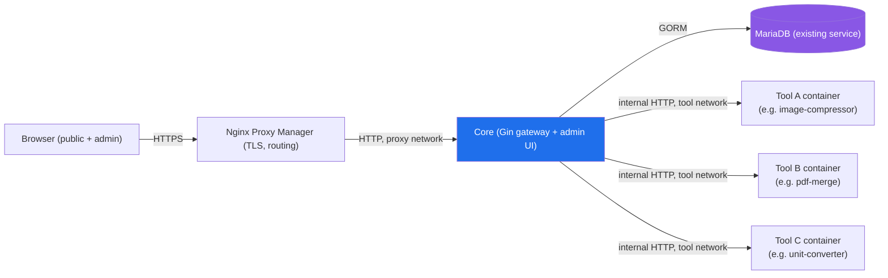
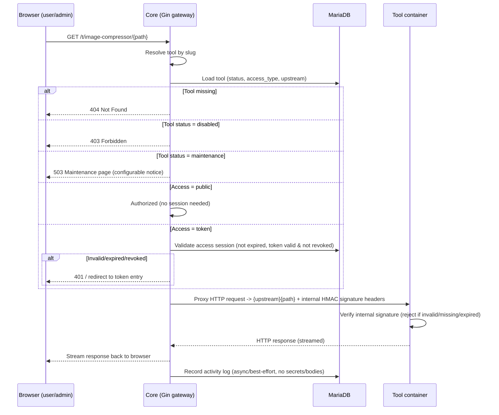

# Tools BPBJ — Architecture

## 1. Overview

**Tools BPBJ** is a centralized web tools portal for Biro Pengadaan Barang/Jasa Provinsi Lampung. It provides a single, branded entry point for internal staff and public visitors to discover and use a catalog of small utility tools (image compression, document conversion, calculators, etc.).

### Goals

- One portal, many independent tools.
- Tools may be written in **any** supported language (Python, PHP, Node.js, Go).
- Two access models: **Public** (no login) and **Token Protected** (token issued by SuperAdmin).
- Administrators manage the tool catalog, statuses, tokens, notices, and view logs.
- Tools are independently deployable, restartable, and updatable.
- Core is the only service exposed to the browser; tools remain internal.

### Non-Goals (Phase 0 / current scope)

- No business features for individual tools are implemented yet.
- No user self-registration; only SuperAdmin exists initially.
- No distributed deployment / horizontal scaling of Core (single instance assumed for now).
- No SSO / external identity provider integration.
- No mutual TLS (mTLS) between Core and tools in the current phase. Internal authentication uses a **per-tool HMAC secret** (see §4.4); mTLS is a documented future option, not a current requirement.

## 2. System Context

- The browser only ever talks to **Core** (via Nginx Proxy Manager).
- **Core** is a reverse-proxy gateway that authenticates/authorizes and forwards to tool services.
- **Tool containers** are reachable only on an internal Docker network; they are never exposed to the public internet.
- **MariaDB** is an existing external service (connection supplied via environment/secrets). An optional local compose profile can run a dev database.

## 3. Component Breakdown

### 3.1 Core Gin Application

The Go/Gin server is the heart of the platform. Responsibilities:

- HTTP routing for the portal, admin UI, auth endpoints, and tool gateway.
- Server-side authorization for every protected action and every proxied tool request.
- Acting as reverse proxy to internal tool services.
- Health monitoring of tools.
- Rendering HTML with Go Templates + HTMX.

**Layering (kept thin):**

| Layer | Package | Responsibility |
|-------|---------|----------------|
| Handlers | `internal/handlers` | Parse requests, call services, render/respond. No business rules. |
| Services | `internal/service` | Business logic: auth, tokens, tool lifecycle, authorization decisions. |
| Repositories | `internal/repository` | Data access via GORM. One repository per aggregate. |
| Models | `internal/model` | GORM models / domain entities. |
| Middleware | `internal/middleware` | Session, CSRF, rate limiting, logging, proxy auth. |
| Proxy | `internal/gateway` | Reverse-proxy implementation and routing by tool slug. |
| Config | `internal/config` | Environment/secret loading and validation. |

**Principles:** handlers are thin; business logic lives in services; DB access lives in repositories; dependencies are injected via constructors.

### 3.2 HTMX + Go Templates Frontend

- **Go Templates** render server-side HTML (no SPA framework).
- **HTMX** provides partial-page updates and progressive enhancement (e.g., status badges, token tables, live health refresh).
- **Tailwind CSS** for styling, compiled at build time to a static asset.
- Templates are organized into a base layout plus per-page partials.
- All state-changing forms are server-validated; HTMX never bypasses server authorization.

### 3.3 MariaDB

- Relational store for admins, sessions, tools, tokens, access sessions, activity logs, and health checks.
- **Existing external service by default.** Core receives connection details via environment variables/secret files.
- An **optional Docker Compose profile** (`dev-db`) can start a local MariaDB for development only.

### 3.4 GORM Integration

- GORM is used for all application data access.
- Models live in `internal/model`; repositories wrap GORM queries so business logic is not coupled to GORM specifics.
- Use context-aware queries (`WithContext`) and explicit error handling.
- No `AutoMigrate` in production — schema changes go through golang-migrate.

### 3.5 golang-migrate

- All schema changes are versioned migration files (`000001_init.up.sql` / `.down.sql`).
- Migrations run as an explicit deploy step (a dedicated migrate job/container), never automatically mutating production by side effect at startup without control.
- Production schemas are never edited manually.

### 3.6 Administrator Authentication

- Single SuperAdmin initially; model supports a `role` field for future expansion.
- Passwords hashed with **Argon2id** (preferred) or bcrypt.
- Server-side sessions stored in `admin_sessions` (only a hash of the session token is stored).
- Secure, HttpOnly, SameSite session cookies over HTTPS.
- Login rate limiting and CSRF protection on admin forms (see `security-design.md`).

### 3.7 Tool Registry

- The **database is authoritative** for tool identity, upstream address, access type, and status.
- A tool ships a **manifest** (JSON) that acts as **seed/config** data. SuperAdmin can import the manifest via Admin UI or create a tool manually.
- Operational status (draft / active / maintenance / disabled) and security configuration are stored **only** in the DB and override manifest defaults.
- Registering a new tool requires **no Core source-code changes** (see §5).

### 3.8 Token Authorization

- A token grants access to **exactly one** tool.
- Recipient identity is a **descriptive label only**, not a verified identity.
- Only a **secure hash** of the token is stored; plaintext is shown once at generation.
- Tokens have configurable expiration and can be revoked at any time.
- Possessing a valid token is what authorizes access — anyone with the token can use it.

### 3.9 Reverse Proxy / Gateway

- Core exposes public routes `/t/{tool-slug}/…`.
- Before forwarding, Core authorizes the request (admin session or tool token session) and enforces tool status.
- Core **validates the upstream URL against an allowlist policy** before any connection attempt (SSRF prevention — see §4.5).
- Core signs every forwarded request with a **per-tool** internal authentication signature so the tool can verify the caller is genuinely Core (see §4.4), and proxies using Go's `httputil.ReverseProxy`, streaming bodies both ways (file uploads/downloads are supported).
- Tools are never exposed directly to the internet; only Core reaches them on the internal network. **Network isolation is defense-in-depth, not proof of identity** — the internal signature is what authenticates Core to the tool.

### 3.10 Independent Docker Compose Deployments for Tools

- Each tool has its own directory, `Dockerfile`, and compose/deploy definition.
- A tool can be built, restarted, updated, or rolled back independently.
- Tools attach to an **internal-only** Docker network that connects them to Core.
- Adding or updating a tool does not require rebuilding or redeploying Core.

## 4. How Core Communicates with Independent Tool Services

Core uses a **reverse-proxy passthrough** model. Core is the single **user-facing** authorization point; every forwarded request is HMAC-signed and verified by the tool, so tools accept requests **only from an authenticated Core**, not merely from the internal network.

### 4.1 Request Flow

### 4.2 Key Behaviors

| Concern | Behavior |
|---------|----------|
| Route shape | `/t/{slug}/...`; slug is unique and DB-controlled. |
| Authorization | Server-side, every request: tool status + (session or token session). |
| Upstream resolution | From `tools.upstream_url` in the DB — never hardcoded in Core. |
| Upstream validation | Allowlisted (internal host, scheme, port) before connecting — SSRF prevention (§4.5). |
| Internal auth | Every forwarded request carries a **per-tool** HMAC signature (with `keyId`) + timestamp + mandatory nonce (§4.4). |
| Body handling | Streamed both directions (no full buffering) to support large uploads. |
| Client auth headers | Stripped; Core injects its own identifying + signature headers (see §4.4). |
| Upstream down | `502 Bad Gateway` with a friendly error page. |
| Upstream slow/timeout | `504 Gateway Timeout` on proxy timeout. |
| Maintenance | Render the configurable maintenance notice; container need not be stopped. |
| Disabled | Deny access (`403`). |
| Health checks | Core periodically polls each tool's `healthcheck` path with bounded timeout/concurrency (§4.6). |
| Logging | Every proxied access recorded in `activity_logs` — metadata only, never secrets or bodies (§4.7). |

### 4.3 Network Isolation

- Tools listen only on the **internal tool network**; no published host ports.
- Only Core (and Nginx Proxy Manager at the edge) are reachable from the browser side.
- Tools never need to know about the public origin or admin auth.
- **Important:** network isolation is necessary but **not sufficient** as identity proof. A compromised or misconfigured container on the same network could otherwise impersonate Core. Every forwarded request is therefore authenticated with an internal HMAC signature (§4.4), independent of the network boundary.

### 4.4 Internal Authentication (Core → Tool)

Core does **not** rely on the private Docker network as proof of identity. Every proxied request to a tool is signed with an **HMAC secret that is unique per tool**, and each tool verifies the signature before processing.

**Scheme (HMAC request signing):**

| Header | Purpose |
|--------|---------|
| `X-Gateway: tools-bpbj-core` | Identifies the logical caller (informational). |
| `X-Signature-Key-Id` | Identifier of the secret (key) used to sign (supports rotation, see below). |
| `X-Signature-Timestamp` | Unix epoch (seconds) when the signature was produced. |
| `X-Signature-Nonce` | Random per-request value (replay protection). |
| `X-Signature` | HMAC-SHA256 over a canonical string (below), hex-encoded. |

**Canonical string signed:** `METHOD + "\n" + path + "\n" + query + "\n" + keyId + "\n" + timestamp + "\n" + nonce + "\n" + bodyHash`. **`bodyHash` is the hash of the actual body bytes for every request that carries a body — there is no bodyless marker for uploads.** For streamed uploads, Core hashes the stream incrementally and covers the resulting digest with the signature (delivered via a signed `Content-Digest`/`X-Signature-Body-Digest` the tool verifies against the received bytes); a request whose body integrity cannot be verified is rejected, never processed on timestamp+nonce alone.

**Per-tool secret (no global shared secret):**

- Each tool has its **own distinct HMAC secret**. There is **no single global shared secret** across tools. Compromise of one tool's secret does not grant the ability to impersonate Core to any other tool.
- Core stores the per-tool secret material for signing; the matching secret is delivered to that tool via **secret file / env**. A secret is identified by a `keyId` sent in `X-Signature-Key-Id`.
- Secrets are **never hardcoded, committed, or placed in the manifest**.

**Secret rotation with zero-downtime transition:**

- A tool may hold **two valid secrets at once**: the **current** and the **next** (incoming) key, each with its own `keyId`.
- Rotation procedure: (1) generate the new key, (2) deliver it to the tool so the tool accepts **both** old and new during the transition window, (3) switch Core to sign with the new key, (4) after the transition window (and once old-key traffic has drained) revoke the old key from the tool.
- During the transition window either key verifies successfully, so rotation causes **no downtime**. The transition window is bounded and configurable.
- The tool validates the incoming `X-Signature-Key-Id`, selects the matching secret (current or next), and verifies.
- Revocation of a retired key is immediate once transition traffic has drained.

**Rules:**

- The tool **rejects** (`401`, not processed) any request that is missing the signature headers, carries an unknown/revoked `keyId`, has an invalid signature, or whose `X-Signature-Timestamp` is outside a small clock-skew window (default plus/minus 60 seconds, env `HMAC_SKEW`).
- Replay protection is **mandatory** via a nonce cache with a TTL keyed by `keyId`+nonce (see §4.4.1).
- Per-tool signing/verification keys are **not** the same as user tokens or admin session secrets.
- This is documented as the **integration contract obligation** for every tool (see `tool-integration.md`). Tools that ignore verification are considered non-compliant.
- **Future option:** mTLS between Core and tools can replace/augment HMAC; it is out of scope for Phase 0 (see §1 Non-Goals).

#### 4.4.1 Replay Protection (Mandatory Nonce Cache)

- Every signed request carries a unique random `X-Signature-Nonce`.
- The tool **MUST** reject a nonce it has already accepted for the same `keyId` — replay protection is **required**, not optional.
- Implementation: a **nonce store keyed by `keyId`+nonce** with a **TTL at least as long as the accepted clock-skew window** (env `NONCE_TTL`, default 2 minutes, which must be at least 2x `HMAC_SKEW`). In a distributed deployment the store is shared and the check-and-store is atomic; a purely in-memory cache is acceptable only for a single instance or tests. Entries older than the TTL are evicted.
- A repeated `keyId`+nonce within the TTL window is rejected with `401` and is not processed.
- **The check-and-store MUST be atomic:** the "have I seen this nonce?" test and the "record this nonce" write are a single atomic operation (insert-if-absent / compare-and-set / atomic map op). A non-atomic check-then-insert would let two concurrent replays carrying the same nonce both pass; with an atomic op, exactly one is admitted and the others are rejected.
- The cache is bounded (size and per-tool scope) to prevent it from becoming a memory/DoS vector; eviction is by TTL/size.
- Without the cache, a captured request could be replayed within the skew window; the cache closes that gap.

### 4.5 Upstream URL Validation (SSRF Prevention)

Because `upstream_url` ultimately comes from a manifest/Admin input, Core must validate it before ever connecting, to prevent Server-Side Request Forgery and access to unauthorized services.

**Validation rules (enforced on save AND before each connection):**

- **Scheme:** only `http` or `https`. Reject `file://`, `gopher://`, `ftp://`, `ldap://`, etc.
- **Host type:** only a **Docker service hostname** (e.g. `image-compressor`) or an explicit **allowlisted internal host/IP range** (RFC1918 / Docker internal DNS). Reject `localhost`, `127.0.0.0/8`, `::1`, `169.254.0.0/16` (link-local / cloud metadata), and any public host.
- **Port:** restricted to an allowlisted set (tool ports), not arbitrary.
- **Path:** no traversal (`..`), no userinfo (`user:pass@`), no encoded host tricks.
- **Connect-to-validated-IP (DNS rebinding):** resolving the host and checking the IP **before** connecting is not enough — a rebind can change the answer between the check and the actual connection (TOCTOU). Core **MUST** therefore ensure the **IP it validated is the exact IP it connects to**. Concretely: resolve once, validate that resolved IP against the allowlist, then **dial that specific validated IP directly** (pin the IP) so no second, unvalidated resolution happens; preserve `Host`/SNI for TLS. Do **not** perform a fresh DNS lookup at connect time that could return a different IP.
- **Redirects:** Core **must not** blindly follow upstream redirects to disallowed hosts; redirects to non-allowlisted addresses are blocked. Any redirect target is re-validated with the same pinned-IP rule.
- **Egress from Core:** outbound connections from Core are restricted to the internal tool network where practical.

**Enforcement points:** manifest import validation, Admin create/edit validation, and a final pre-connection guard in the gateway. A violation yields a clear error and is recorded in `activity_logs`.

### 4.6 Health-Check Limits (Core & Tools)

Health polling must not overload Core or the tools. The implementation bounds are
(env keys are set in `core.env`):

| Parameter | Default | Env key | Notes |
|-----------|---------|---------|-------|
| Interval | **30s** per tool | `HEALTHCHECK_INTERVAL` | `0` disables the poller entirely. |
| Per-check timeout | **5s** | `HEALTHCHECK_TIMEOUT` | Hard timeout; a slow tool is marked unhealthy, never hangs the poller. |
| Max concurrency | **5** simultaneous checks | `HEALTHCHECK_MAX_CONCURRENT` | Prevents a burst across many tools from spiking Core. |
| Retries | **none** within a sweep | - | No retry loop; the next interval is the retry. There is no `HEALTHCHECK_RETRIES`. |
| Global poll budget | skip if the previous sweep is still running | - | No overlapping sweeps. |
| Per-tool overlap | refused | - | A second concurrent probe of the same tool is rejected. |
| Result write | one row per tool per sweep | - | Bounds `tool_health_checks` write load. |

- Polling targets the tool's `healthcheck` path only (must start with `/`; a `..` sequence is rejected); it does **not** generate proxied user traffic.
- Only **active**, non-soft-deleted tools are polled.
- A tool that is slow/unhealthy does not block checks of other tools (isolation per check). The check body is drained up to 4 KiB.
- Health checks reuse the **same SSRF allowlist and pinned-IP policy** as the gateway.
- Health polling does **not** change tool status automatically - status remains an admin decision (see 4.2).
- Stored `error_message` is a **fixed reason code**, never raw transport text: `timeout`, `connection failed`, `tls handshake failed`, `upstream address not allowed`, `unexpected status code`, `response body too large`, `request failed`.

### 4.7 Activity Log Rules (No Sensitive Data)

`activity_logs` is **metadata only**. The following MUST NEVER be stored in `activity_logs` (or any log): tokens, session IDs, cookies, passwords/password hashes, `Authorization` headers, request/response bodies, and uploaded file contents.

- Logged: actor type/id (as identifiers, not secrets), action, entity type/id, tool id, IP, user agent, timestamps, and sanitized non-sensitive metadata.
- Any header/field captured for diagnostics is explicitly allowlisted; everything else is dropped.
- This rule applies to application logs (stdout/stderr) as well as the audit table.

## 5. How a New Tool Is Registered Without Modifying Core Source Code

The DB drives routing and authorization; Core code is generic. The registration flow:

1. **Tool author** ships a container with:
   - a `Dockerfile`,
   - a `manifest.json` (see `tool-integration.md`),
   - a health endpoint (e.g. `GET /health`).
2. **Deploy** the tool container onto the internal tool network (its own compose file). It gets an internal hostname (e.g. `image-compressor`).
3. **Register** in Core:
   - SuperAdmin opens **Admin → Tools → Import/New**.
   - Imports the manifest (or fills the form manually).
   - Core validates the manifest and creates a `tools` row (snapshotted into `manifest_json`).
4. **Configure** (DB-authoritative):
   - Set/confirm `access_type` (public or token).
   - Set `status` to `active` when ready (defaults to `draft`).
   - Optionally set maintenance message, display order, category.
5. **Use:** the tool is instantly reachable at `/t/{slug}/...` — **no Core rebuild or redeploy required**.

> Because routing, upstream, access, and status all live in the DB, adding tools is a data + deployment operation, not a code change.

## 6. Communication Contract (Summary)

- **Protocol:** synchronous HTTP/1.1 between Core and tools.
- **Payloads:** JSON for APIs and health; arbitrary content-types streamed through the proxy for tool functionality.
- **Internal auth:** every core→tool request is HMAC-signed with a **per-tool** key and verified by the tool (§4.4); replay is prevented by a mandatory nonce cache (§4.4.1). Network isolation alone is not identity.
- **Upstream safety:** upstream URLs are validated against an internal allowlist (§4.5).
- **Health:** every tool MUST expose a health endpoint returning HTTP 200 and a JSON status; polling is bounded by timeout/interval/concurrency (§4.6).
- **Logging:** metadata only — no tokens, cookies, passwords, auth headers, or bodies (§4.7).
- **Trust model:** tools verify the internal signature; they must be reachable only from Core.
- Full contract details: see `tool-integration.md`.

## 7. Separation of Concerns

- **Handlers** never contain business rules.
- **Services** own authorization and lifecycle decisions.
- **Repositories** own persistence.
- **Gateway** owns proxying only; authorization happens before proxying.
- **Middleware** centralizes cross-cutting concerns (session, CSRF, rate limit, request logging).

## 8. Related Documents

- `database-design.md` — schema.
- `tool-integration.md` — manifest + request/response contract.
- `security-design.md` — security model.
- `deployment-design.md` — Docker/deployment.
- `phase-0-report.md` — discovery, risks, open questions.
