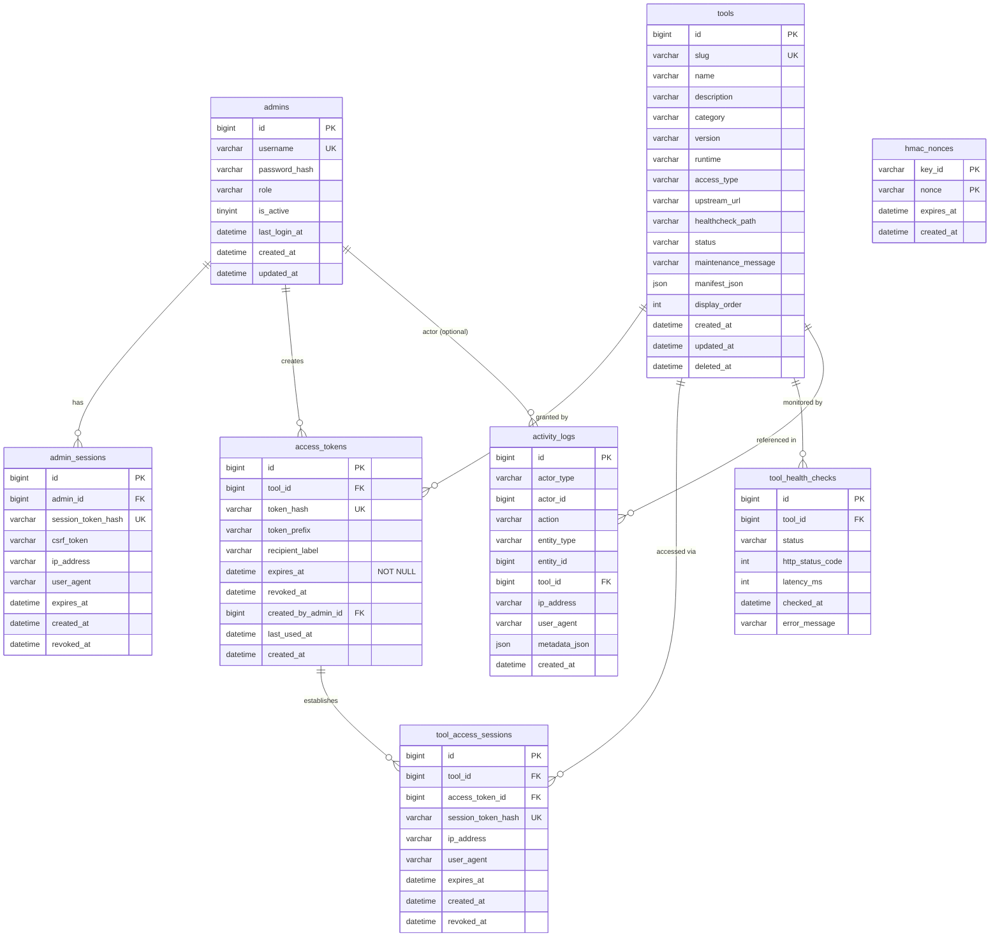

# Tools BPBJ — Database Design

## 1. Overview

This document proposes the initial relational schema for Tools BPBJ. It is a **design proposal only** — no migrations are executed and no production tables are created in this phase.

### Engine & Conventions

- **Database:** MariaDB (existing external service by default; optional local compose profile for dev).
- **Storage engine:** InnoDB.
- **Charset/Collation:** `utf8mb4` / `utf8mb4_unicode_ci`.
- **Primary keys:** `BIGINT UNSIGNED AUTO_INCREMENT`.
- **Timestamps:** `DATETIME(3)` in UTC (millisecond precision for ordering/audit). Application stores UTC; rendering converts to local time.
- **Booleans:** `TINYINT(1)`.
- **Enums:** stored as `VARCHAR` with a CHECK or application-level validation (MariaDB enum type is avoided for easier evolution); the documented value set is authoritative.
- **Soft delete:** used only where an audit trail matters (`tools`). Security tables use explicit `revoked_at` / `expires_at` rather than soft delete.
- **Schema management:** golang-migrate. Migrations are versioned pairs, e.g. `000001_init.up.sql` / `000001_init.down.sql` and `000002_hmac_nonces.up.sql` / `000002_hmac_nonces.down.sql`. Migrations own all schema changes.
- **Data access:** GORM models map 1:1 to these tables; no `AutoMigrate` in production.

## 2. Entity-Relationship Overview

## 3. Table Designs

### 3.1 `admins`

**Purpose:** Stores administrator accounts. Initially a single SuperAdmin; the `role` column future-proofs for multiple admin types.

| Column | Type | Constraints | Notes |
|--------|------|-------------|-------|
| `id` | BIGINT UNSIGNED | PK, AUTO_INCREMENT | |
| `username` | VARCHAR(64) | NOT NULL, UNIQUE | Login identifier. |
| `password_hash` | VARCHAR(255) | NOT NULL | Argon2id/bcrypt hash only. |
| `role` | VARCHAR(32) | NOT NULL, DEFAULT 'superadmin' | `superadmin` (future: `admin`, `viewer`). |
| `is_active` | TINYINT(1) | NOT NULL, DEFAULT 1 | Disable without deleting. |
| `last_login_at` | DATETIME(3) | NULL | Updated on successful login. |
| `created_at` | DATETIME(3) | NOT NULL | |
| `updated_at` | DATETIME(3) | NOT NULL | |

**Relationships:** One admin → many `admin_sessions`; one admin → many `access_tokens` (created_by); one admin → many `activity_logs` (actor).

**Indexes:** `PRIMARY(id)`; `UNIQUE(username)`.

**Security considerations:**
- Store only `password_hash`; never plaintext or reversible encryption.
- `username` unique to prevent account-confusion.
- `is_active=0` disables login without destroying audit history.

---

### 3.2 `admin_sessions`

**Purpose:** Server-side admin sessions enabling revocable authentication and session-bound CSRF tokens.

| Column | Type | Constraints | Notes |
|--------|------|-------------|-------|
| `id` | BIGINT UNSIGNED | PK | |
| `admin_id` | BIGINT UNSIGNED | NOT NULL, FK → admins(id) ON DELETE CASCADE | |
| `session_token_hash` | VARCHAR(255) | NOT NULL, UNIQUE | Hash of the cookie's session token (never plaintext). |
| `csrf_token` | VARCHAR(255) | NOT NULL | Per-session CSRF secret (may be hash of form token). |
| `ip_address` | VARCHAR(45) | NULL | IPv4/IPv6 of session creation. |
| `user_agent` | VARCHAR(512) | NULL | For anomaly detection/display. |
| `expires_at` | DATETIME(3) | NOT NULL | Absolute expiry. |
| `created_at` | DATETIME(3) | NOT NULL | |
| `revoked_at` | DATETIME(3) | NULL | Set on logout or forced revocation. |

**Relationships:** Many sessions → one admin.

**Indexes:** `PRIMARY(id)`; `UNIQUE(session_token_hash)` (fast lookup + uniqueness); `INDEX(admin_id)`; `INDEX(expires_at)` (cleanup job).

**Security considerations:**
- Only the **hash** of the session token is stored; a DB leak does not yield usable cookies.
- `expires_at` enforces absolute lifetime; sessions also expire on logout (`revoked_at`).
- Lookups must reject rows where `revoked_at IS NOT NULL` or `expires_at <= now`.

---

### 3.3 `tools`

**Purpose:** The authoritative tool registry. Drives routing, access control, status enforcement, and proxying.

| Column | Type | Constraints | Notes |
|--------|------|-------------|-------|
| `id` | BIGINT UNSIGNED | PK | |
| `slug` | VARCHAR(64) | NOT NULL, UNIQUE | URL-safe id used in `/t/{slug}`. |
| `name` | VARCHAR(128) | NOT NULL | Display name. |
| `description` | VARCHAR(512) | NULL | Short description. |
| `category` | VARCHAR(64) | NULL | Grouping. |
| `version` | VARCHAR(32) | NULL | From manifest. |
| `runtime` | VARCHAR(32) | NULL | python/php/node/go. |
| `access_type` | VARCHAR(16) | NOT NULL, DEFAULT 'public' | `public` \| `token`. |
| `upstream_url` | VARCHAR(255) | NOT NULL | Internal URL, e.g. `http://image-compressor:8000`. |
| `healthcheck_path` | VARCHAR(128) | NOT NULL, DEFAULT '/health' | Path polled for health. |
| `status` | VARCHAR(16) | NOT NULL, DEFAULT 'draft' | `draft`\|`active`\|`maintenance`\|`disabled`. |
| `maintenance_message` | VARCHAR(512) | NULL | Shown when status=maintenance. |
| `manifest_json` | JSON | NULL | Raw imported manifest snapshot (reference). |
| `display_order` | INT | NOT NULL, DEFAULT 0 | Catalog ordering. |
| `created_at` | DATETIME(3) | NOT NULL | |
| `updated_at` | DATETIME(3) | NOT NULL | |
| `deleted_at` | DATETIME(3) | NULL | Soft delete (retain audit references). |

**Relationships:** One tool → many `access_tokens`; one tool → many `tool_access_sessions`; one tool → many `tool_health_checks`; one tool → many `activity_logs`.

**Indexes:** `PRIMARY(id)`; `UNIQUE(slug)`; `INDEX(status)`; `INDEX(category)`; `INDEX(deleted_at)`.

**Security considerations:**
- `status` and `access_type` are enforced **server-side on every request** — never trusted from the manifest or client.
- `upstream_url` is DB-controlled and **must pass SSRF validation before storage and again before each connection**: scheme `http`/`https` only; Docker service hostname or allowlisted internal IP range; allowlisted port; no userinfo/traversal; DNS rebinding prevented by **connecting to the exact validated IP** (pinned IP, no second unvalidated lookup). Public hosts, `localhost`, link-local (`169.254.0.0/16`), and cloud-metadata addresses are rejected (see `architecture.md` §4.5 / `security-design.md` §11.2).
- Soft delete keeps historical references intact; deleted tools are hidden and unreachable.

---

### 3.4 `access_tokens`

**Purpose:** Tokens that grant access to exactly **one** tool.

| Column | Type | Constraints | Notes |
|--------|------|-------------|-------|
| `id` | BIGINT UNSIGNED | PK | |
| `tool_id` | BIGINT UNSIGNED | NOT NULL, FK → tools(id) | **One token = one tool.** |
| `token_hash` | VARCHAR(255) | NOT NULL, UNIQUE | Hash only; plaintext shown once at creation. |
| `token_prefix` | VARCHAR(16) | NOT NULL | Short display prefix for admin UI (e.g. `tbpbj_ab12`). |
| `recipient_label` | VARCHAR(128) | NULL | Descriptive label only — NOT verified identity. |
| `expires_at` | DATETIME(3) | **NOT NULL** | **Mandatory expiry** — every token must expire; no non-expiring tokens allowed. |
| `revoked_at` | DATETIME(3) | NULL | Set on revocation. |
| `created_by_admin_id` | BIGINT UNSIGNED | NOT NULL, FK → admins(id) | Issuer. |
| `last_used_at` | DATETIME(3) | NULL | Updated on use. |
| `created_at` | DATETIME(3) | NOT NULL | |

**Relationships:** Many tokens → one tool; many tokens → one admin (creator); one token → many `tool_access_sessions`.

**Indexes:** `PRIMARY(id)`; `UNIQUE(token_hash)`; `INDEX(tool_id)`; `INDEX(expires_at)`; `INDEX(revoked_at)`.

**Security considerations:**
- Store only `token_hash`; plaintext displayed once and never persisted.
- Validation must check `revoked_at IS NULL` and `expires_at > now` (expiry is mandatory, so `expires_at` is never NULL).
- **Anyone possessing a valid token can use it** — `recipient_label` is documentation, not authentication. This must be stated in the UI.

---

### 3.5 `tool_access_sessions`

**Purpose:** Short-lived user sessions established after presenting a valid token, so the token need not be resent on every request.

| Column | Type | Constraints | Notes |
|--------|------|-------------|-------|
| `id` | BIGINT UNSIGNED | PK | |
| `tool_id` | BIGINT UNSIGNED | NOT NULL, FK → tools(id) | |
| `access_token_id` | BIGINT UNSIGNED | NOT NULL, FK → access_tokens(id) | Origin token. |
| `session_token_hash` | VARCHAR(255) | NOT NULL, UNIQUE | Hash of session cookie token. |
| `ip_address` | VARCHAR(45) | NULL | |
| `user_agent` | VARCHAR(512) | NULL | |
| `expires_at` | DATETIME(3) | NOT NULL | **Must not exceed token expiry.** |
| `created_at` | DATETIME(3) | NOT NULL | |
| `revoked_at` | DATETIME(3) | NULL | |

**Relationships:** Many sessions → one tool; many sessions → one access token.

**Indexes:** `PRIMARY(id)`; `UNIQUE(session_token_hash)`; `INDEX(tool_id)`; `INDEX(access_token_id)`; `INDEX(expires_at)`.

**Security considerations:**
- Session expiry is **bounded by** the token's `expires_at`: `session.expires_at = min(now + TTL, token.expires_at)`.
- Revoking a token must invalidate its derived sessions (checked at request time by joining/validating the token, or by eagerly marking sessions revoked).
- Only hashes stored.

---

### 3.6 `activity_logs`

**Purpose:** Append-only audit trail of meaningful actions (admin actions, tool access, token lifecycle).

| Column | Type | Constraints | Notes |
|--------|------|-------------|-------|
| `id` | BIGINT UNSIGNED | PK | |
| `actor_type` | VARCHAR(16) | NOT NULL | `admin`\|`token`\|`anonymous`\|`system`. |
| `actor_id` | BIGINT UNSIGNED | NULL | admin.id or access_token_id depending on type. |
| `action` | VARCHAR(64) | NOT NULL | e.g. `tool.access`, `token.create`, `admin.login`. |
| `entity_type` | VARCHAR(32) | NULL | e.g. `tool`, `token`, `admin`. |
| `entity_id` | BIGINT UNSIGNED | NULL | Target entity id. |
| `tool_id` | BIGINT UNSIGNED | NULL, FK → tools(id) | Convenience for tool-scoped queries. |
| `ip_address` | VARCHAR(45) | NULL | |
| `user_agent` | VARCHAR(512) | NULL | |
| `metadata_json` | JSON | NULL | Extra structured context. |
| `created_at` | DATETIME(3) | NOT NULL | |

**Relationships:** Optional many → one tool; optional many → one admin.

**Indexes:** `PRIMARY(id)`; `INDEX(created_at)`; `INDEX(tool_id)`; `INDEX(actor_type, actor_id)`.

**Security considerations:**
- Append-only: no UPDATE/DELETE in normal operation.
- `metadata_json` is **allowlisted metadata only**. It MUST NEVER contain: tokens/token plaintext, session IDs/cookies, passwords/password hashes, `Authorization` headers or internal `X-Signature*` values, request/response bodies, or uploaded file contents. See `security-design.md` §12.
- Consider retention/pruning policy for long-term growth (see §5).

---

### 3.7 `tool_health_checks`

**Purpose:** Stores health-monitoring results over time for status display and history.

| Column | Type | Constraints | Notes |
|--------|------|-------------|-------|
| `id` | BIGINT UNSIGNED | PK | |
| `tool_id` | BIGINT UNSIGNED | NOT NULL, FK → tools(id) | |
| `status` | VARCHAR(16) | NOT NULL | `healthy`\|`unhealthy`\|`unknown`. |
| `http_status_code` | INT | NULL | Upstream HTTP status. |
| `latency_ms` | INT | NULL | Round-trip latency. |
| `checked_at` | DATETIME(3) | NOT NULL | When checked. |
| `error_message` | VARCHAR(512) | NULL | Failure reason if any. |

**Relationships:** Many → one tool.

**Indexes:** `PRIMARY(id)`; `INDEX(tool_id, checked_at)` (latest + history per tool); `INDEX(checked_at)` (retention prune).

**Security considerations:**
- `error_message` must not leak credentials or internal secrets; truncate and sanitize. The implementation stores only a **fixed reason code** (`timeout`, `connection failed`, `tls handshake failed`, `upstream address not allowed`, `unexpected status code`, `response body too large`, `request failed`), never raw transport text that could echo hostnames/IPs.
- Retention: prune rows older than a configured window to bound growth (not yet automated).
- **Write rate is bounded by Core's health-check limits** (interval 30s, timeout 5s, bounded concurrency; see `architecture.md` section 4.6). The table is a bounded history + latest-status source, not a high-volume log.

### 3.8 `hmac_nonces` (internal HMAC replay protection)

**Purpose:** Atomic replay protection for the internal Core to tool HMAC signature. A nonce accepted once for a given `keyId` cannot be accepted again within its TTL. Introduced by migration `000002_hmac_nonces`.

| Column | Type | Constraints | Notes |
|--------|------|-------------|-------|
| `key_id` | VARCHAR(64) | NOT NULL, part of composite PK | The `X-Signature-Key-Id` the nonce was signed with. |
| `nonce` | VARCHAR(128) | NOT NULL, part of composite PK | The `X-Signature-Nonce` value (public, not a secret). |
| `expires_at` | DATETIME(3) | NOT NULL | When the nonce may be reused (now + `NONCE_TTL`). |
| `created_at` | DATETIME(3) | NOT NULL | When accepted. |

**Primary key:** `PRIMARY KEY (key_id, nonce)`; the composite key makes check-and-store a **single atomic** operation (`INSERT ... ON DUPLICATE KEY UPDATE`): a duplicate live row means replay (rejected), an expired duplicate is replaced.

**Indexes:** `PRIMARY(key_id, nonce)`; `INDEX(expires_at)` (for the Core janitor that prunes expired rows).

**Security considerations:**
- Stores only **public nonce values** and the key identifier; never secret material.
- Replay storage unavailability **fails closed** (the request is rejected), per the internal-auth contract.
- `NONCE_TTL` must be at least `2x HMAC_SKEW`. A background janitor prunes expired rows.

## 4. Referential Integrity Summary

| Child | FK | Parent | On Delete |
|-------|----|--------|-----------|
| admin_sessions.admin_id | → | admins.id | CASCADE |
| access_tokens.tool_id | → | tools.id | RESTRICT (tools are soft-deleted) |
| access_tokens.created_by_admin_id | → | admins.id | RESTRICT |
| tool_access_sessions.tool_id | → | tools.id | CASCADE (or RESTRICT w/ soft delete) |
| tool_access_sessions.access_token_id | → | access_tokens.id | CASCADE |
| tool_health_checks.tool_id | → | tools.id | CASCADE |
| activity_logs.tool_id | → | tools.id | SET NULL |

Tools use soft delete, so FKs to tools remain valid; hard deletion is not a routine operation. `hmac_nonces` has **no** foreign keys (it is keyed by `key_id`+`nonce`, independent of the tool rows).

## 5. GORM & Migration Notes

- **GORM model conventions:** structs in `internal/model`, table names via `TableName()`, timestamps via `CreatedAt`/`UpdatedAt`/`DeletedAt`. Note: `model.Tool.DeletedAt` is a `*time.Time` (matching the `deleted_at DATETIME(3) NULL` column), not `gorm.DeletedAt`; therefore tool queries filter `deleted_at IS NULL` explicitly rather than relying on GORM soft-delete scoping.
- **Migration naming:** `000001_init.up.sql` / `000001_init.down.sql`, incrementing for each change. Migrations are the single source of truth for schema.
- **Run method:** a dedicated migrate step (container/job) in deployment; not auto-run destructively at app start in production.

## 6. Future Considerations (not implemented now)

- **`activity_logs` partitioning** by month if volume grows large.
- **Token scopes/limits** (per-token IP allowlist, usage caps) if requirements expand — deliberately omitted now to avoid over-engineering.
- **Separate `tool_categories` table** if categories need metadata; for now a `category` string suffices.
- **Reader replica** for reporting if log volume impacts primary.
