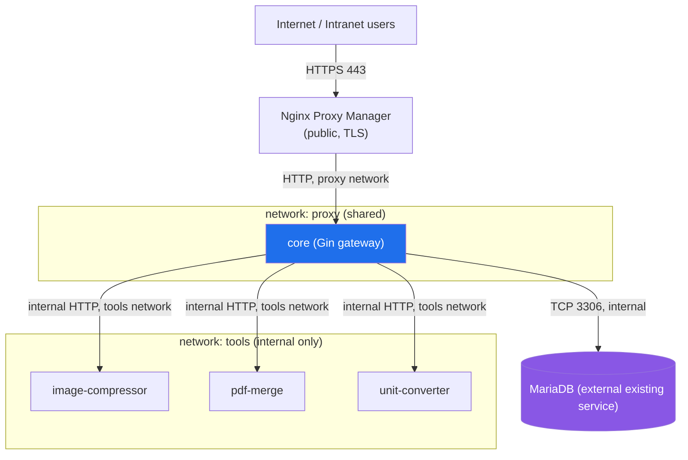
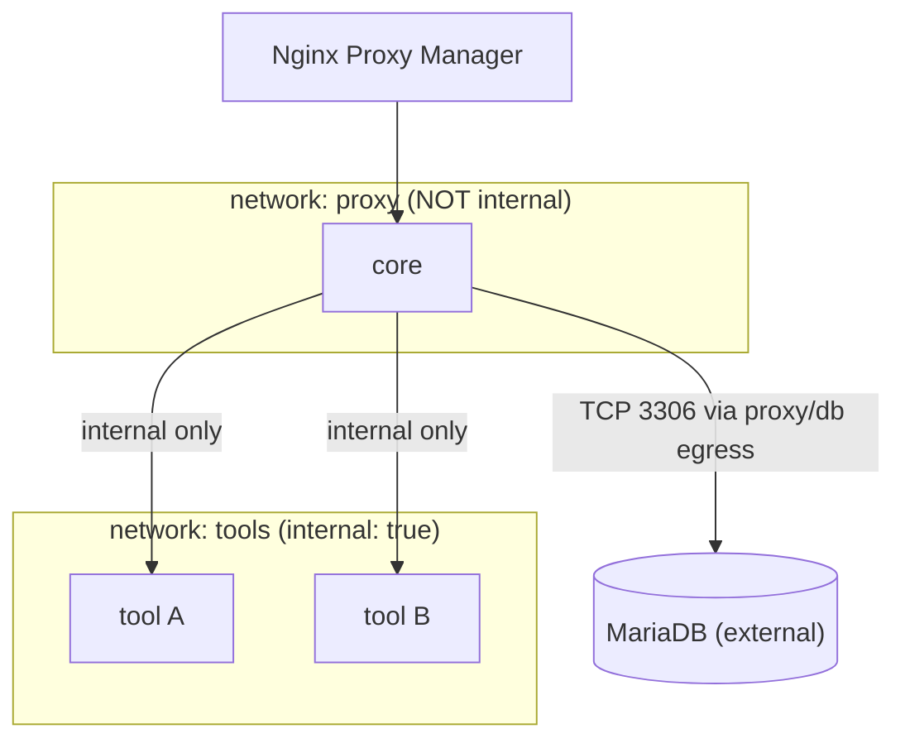

# Tools BPBJ — Deployment Design

This document proposes how Tools BPBJ is deployed with Docker and Docker Compose. It is a **design proposal** — no containers are built or deployed in this phase, and the existing production server / Docker configuration is not modified.

## 1. Deployment Principles

- **Core and every tool are independently deployable.**
- **No internal service ports are exposed publicly.** Only Nginx Proxy Manager is public.
- **Shared network `proxy`** carries edge ↔ Core traffic.
- **Internal-only network** carries Core ↔ tool traffic.
- **Database is an existing external MariaDB service** (connection via env/secret); an optional compose profile runs a local DB for development.
- **Health checks and resource limits** on every container.
- **Documented build / deploy / restart / rollback** procedures.
- **No production deployment without explicit Product Owner approval.**

## 2. Topology



- **NPM** terminates TLS and reverse-proxies to Core (no direct tool routing).
- **Core** joins both `proxy` (for NPM) and `tools` (for tools) networks.
- **Tools** join only `tools` (no `proxy`, no published ports).
- **MariaDB** is reached over a trusted internal path configured externally.

## 3. Docker Compose Layout

### 3.1 Core (`deploy/core/docker-compose.yml`) — sketch

```yaml
services:
  core:
    build:
      context: ../../
      dockerfile: deploy/core/Dockerfile
    image: tools-bpbj/core:${CORE_VERSION:-latest}
    restart: unless-stopped
    env_file:
      - ./core.env           # non-secret config (required)
    environment:
      - DB_DSN_FILE=/run/secrets/db_dsn
      - CSRF_SECRET_FILE=/run/secrets/csrf_secret
      - TOOL_HMAC_KEYS_DIR=/run/secrets/tool-hmac
    secrets:
      - db_dsn
      - csrf_secret
    volumes:
      - ./secrets/tool-hmac:/run/secrets/tool-hmac:ro   # one <slug>.json per tool
    networks:
      - proxy
      - tools
    expose:
      - "8080"               # internal only; NO host publish
    healthcheck:
      test: ["CMD", "/app/core", "-healthcheck"]
      interval: 30s
      timeout: 5s
      retries: 3
      start_period: 20s
    # Portable resource limits for `docker compose` (standalone). See §7.
    mem_limit: 512m
    cpus: 1.0
    pids_limit: 256
    # Hardening
    read_only: true
    cap_drop:
      - ALL
    security_opt:
      - no-new-privileges:true
    tmpfs:
      - /tmp

networks:
  proxy:
    external: true
    name: proxy
  tools:
    external: true
    name: tools
    # NOTE: mark internal:true on the network definition (created on the host);
    # Core reaches MariaDB via `proxy`/dedicated db network, NOT via `tools`. See §4.

secrets:
  db_dsn:
    file: ./secrets/db_dsn.txt
  csrf_secret:
    file: ./secrets/csrf_secret.txt
```

Notes:
- **No `ports:` mapping** for Core — only `expose` (internal). NPM reaches it via the `proxy` network.
- `proxy` and `tools` are **external** networks created once on the host (shared across stacks).
- **`tools` should be created with `internal: true`**; Core retains DB egress via `proxy` (non-internal) or a dedicated `db` network (§4).
- The DB DSN, CSRF secret and per-tool HMAC keys are provided via **secret files / read-only mounts**, not inline env values.
- The runtime image is **read-only, non-root (uid 65532), all capabilities dropped**, with a `tmpfs` for `/tmp`.
- Resource limits use **`mem_limit`/`cpus`/`pids_limit`** (honored by `docker compose` standalone), not only `deploy.resources` (§7).

### 3.2 A Tool (`tools/image-compressor/docker-compose.yml`) — sketch

```yaml
services:
  image-compressor:
    build: .
    image: tools-bpbj/image-compressor:${TOOL_VERSION:-1.0.0}
    restart: unless-stopped
    networks:
      - tools
    expose:
      - "8000"               # internal only; NO host publish
    healthcheck:
      test: ["CMD", "python", "-c", "import urllib.request;urllib.request.urlopen('http://localhost:8000/health')"]
      interval: 30s
      timeout: 5s
      retries: 3
      start_period: 20s
    # Portable resource limits for `docker compose` (standalone). See §7.
    mem_limit: 384m
    cpus: 0.75
    pids_limit: 128

networks:
  tools:
    external: true
    name: tools
```

- Tools join **only** the internal `tools` network; no `proxy`, no published ports.
- Limits use **`mem_limit`/`cpus`/`pids_limit`** so they are actually enforced by `docker compose` standalone (§7).

### 3.3 Optional Dev Database Profile (`deploy/dev/docker-compose.yml`) — sketch

```yaml
services:
  mariadb:
    image: mariadb:11
    profiles: ["dev-db"]
    environment:
      - MARIADB_ALLOW_EMPTY_ROOT_PASSWORD=yes   # DEV ONLY — never production
    networks:
      - tools
    ports:
      - "127.0.0.1:3306:3306"                    # localhost only, dev only
    volumes:
      - dev-db-data:/var/lib/mysql
    healthcheck:
      test: ["CMD", "healthcheck.sh", "--connect", "--innodb_initialized"]
      interval: 10s
      timeout: 5s
      retries: 5

volumes:
  dev-db-data:

networks:
  tools:
    external: true
    name: tools
```

In production, **no DB container is shipped** — Core connects to the existing external MariaDB.

## 4. Networks

| Network | Type | Members | Purpose |
|---------|------|---------|---------|
| `proxy` | external (shared, **not** internal) | NPM, Core | Edge ↔ Core traffic **and** Core → external MariaDB egress |
| `tools` | external (**internal: true**) | Core, all tool containers | Core ↔ tool traffic (no external egress) |

- **Tools never join `proxy`.** **Core never publishes ports.**
- **Egress from Core is restricted to the internal tool network where practical** (supports SSRF prevention — see `architecture.md` §4.5).

#### Core → MariaDB path when `tools` is `internal: true`

An `internal: true` Docker network has **no route to outside networks** (including an external MariaDB). That is exactly what we want for the `tools` network, but it means **Core must not rely on `tools` for DB connectivity**. The path separation is:

- **`tools` network is `internal: true`** — carries only Core ↔ tool traffic; tools cannot egress, and Core's tool-facing traffic cannot escape.
- **Database egress is a separate path**: Core reaches the external MariaDB over the **`proxy` network** (which is **not** internal) *or* over a **dedicated non-internal `db` network** Core joins for DB access only.
- Concretely, Core joins **both** `proxy` (edge) and `tools` (internal). Since `proxy` is not internal, Core retains outbound reachability for the MariaDB connection **through `proxy`**, while `tools` stays fully isolated.
- If the MariaDB lives on an internal network segment that `proxy` cannot reach, define a **dedicated external `db` network** (also non-internal, or a routed internal segment) that Core joins solely for TCP 3306; tools never join it.
- **Rule of thumb:** `internal: true` applies to `tools` **only**. Any network Core needs for edge traffic or DB egress must be **non-internal**. Verify with a connectivity test that Core can reach MariaDB while tools cannot.



## 5. Database Connectivity

- Core connects to the **existing MariaDB** via the DSN supplied either inline (`DB_DSN`) or, preferred in production, as a **secret file** (`DB_DSN_FILE`; takes precedence). Startup **fails fast** if neither is set.
- TLS to the DB enabled where supported.
- A **least-privilege** DB user: only the needed schema/CRUD grants; no `GRANT`/`DROP DATABASE`.
- Migrations use **`golang-migrate`** as a **separate step** (not run by the app; there is **no AutoMigrate**) before starting a new Core version. The DSN for migrations needs `multiStatements=true`.
- The connection is never hardcoded; rotation is documented.

## 6. Health Checks

| Service | Endpoint / check | Interval | Timeout | Retries |
|---------|------------------|----------|---------|---------|
| Core | `GET /health` via the binary probe `["CMD", "/app/core", "-healthcheck"]` | 30s | 5s | 3 (start_period 20s) |
| Each tool | `GET {healthcheck}` (default `/health`) | 30s | 5s | 3 |
| Dev MariaDB | `healthcheck.sh --connect --innodb_initialized` / TCP | 10s | 5s | 5 (start_period 30s) |

- The Core container healthcheck uses the **binary subcommand `-healthcheck`** (not a shell/curl), because the runtime image is distroless and has no shell. The probe calls the app's own `GET /health` endpoint and exits 0 on `200`, non-zero otherwise. There is **no `/healthz`** endpoint.
- The Core app exposes exactly one liveness endpoint: **`GET /health`** (`{"status":"ok","service":"core"}`, unauthenticated).

- Docker health checks govern restart/orchestration; Core additionally polls tools for the dashboard and `tool_health_checks` history.
- **Core-side polling is bounded** (interval/timeout/concurrency — see §10) so it never overloads Core or tools. Docker `healthcheck` and Core's poller are separate mechanisms; keep both bounded.

## 7. Resource Limits

- Every container defines CPU and memory **limits** (and pids).
- Core: e.g. 1.0 CPU / 512 MB; tools: modest defaults (e.g. 0.75 CPU / 384 MB), raised per-tool for heavy workloads (e.g. media processing).
- Prevents a single tool from starving Core or neighbors.

### Compose standalone vs Swarm (`deploy.resources` caveat)

This matters because limits that are silently ignored are worse than none:

- **`deploy.resources.limits`** is the **Swarm** form. With **`docker compose` standalone** it is honored **only** on **Compose v2** (and v1.27+); older versions ignore it.
- **`deploy.resources.reservations`** is **effectively ignored by `docker compose` standalone** (it has no scheduler) — do not rely on it for a non-Swarm deployment.
- The **portable, always-enforced** form for `docker compose up` is the **service-level keys**:
  - `mem_limit` (e.g. `512m`)
  - `cpus` (e.g. `1.0`)
  - `pids_limit` (e.g. `256`)
- **Decision:** use the **service-level `mem_limit`/`cpus`/`pids_limit`** keys in our compose sketches (they are honored by `docker compose` without Swarm). Pin a Compose **v2** CLI and verify enforcement with `docker stats` / `docker inspect`.
- If the platform later moves to Swarm/Kubernetes, translate these to `deploy.resources.limits` (Swarm) or `resources` (K8s).

## 8. Reverse Proxy / Edge (Nginx Proxy Manager)

- **NPM remains the only public entry point**, terminating TLS.
- NPM proxies the portal host to **Core** only; it does not route directly to tools.
- Tool access flows only through Core (`/t/{slug}/...`), preserving server-side authorization.
- **Do not create/modify DNS or NPM settings in this phase** — configuration changes require approval.

## 9. Deployment, Update & Rollback Procedures

### Build & Deploy (Core)

1. Build image: `docker build -f deploy/core/Dockerfile -t tools-bpbj/core:<tag> .` (build context is the repo root).
2. Run migrations: dedicated `golang-migrate` step against the target DB (`multiStatements=true`).
3. Deploy: `docker compose -f deploy/core/docker-compose.yml up -d`.
4. Verify health: `docker inspect --format '{{.State.Health.Status}}' mycoreplat-core` and a smoke test through NPM.

### Update a Tool

1. Bump `TOOL_VERSION`; build the new image.
2. `docker compose up -d` for that tool only (independent of Core and other tools).

### Rollback a Tool

1. Set `TOOL_VERSION` back to the previous tag.
2. `docker compose up -d` to re-create the container from the prior image.
3. Verify health check; adjust status if necessary.

### Rollback Core

1. Set `CORE_VERSION` (or the `image:` tag) back to the previous Core image and `docker compose up -d`.
2. Run **down** migrations only if the release included backward-incompatible schema changes (coordinate explicitly; prefer additive/backward-compatible migrations).

### Restart

- `docker compose -f deploy/core/docker-compose.yml restart core` — per service; independent.

> Full step-by-step operational procedures (prerequisites, networks, secrets, backup/restore, troubleshooting, recovery) are in **`docs/deployment-guide.md`**.

## 10. Secrets Management

- Use Docker **secrets** or mounted secret files for:
  - DB DSN (`DB_DSN_FILE`),
  - CSRF HMAC key (`CSRF_SECRET_FILE`),
  - **per-tool internal Core→tool HMAC key file(s)** (`TOOL_HMAC_KEYS_DIR`; each tool has its **own** file and secret; no global shared secret).
- Each per-tool key is identified by a `keyId`. Core reads the key material from `TOOL_HMAC_KEYS_DIR/<slug>.json`; each entry is `{"keyId","secret"(base64),"status":"active|previous|revoked","notAfter"}`. The keystore reloads automatically on file change, so rotation needs no restart.
- **Dual-key rotation (no downtime):** add a new `active` key to the tool's file and demote the old one to `previous` with an optional `notAfter` transition deadline; after the window, mark it `revoked` (immediately rejected). There is **no** global rotation-window env var — the transition is expressed by key status in the file.
- Never bake secrets into images or commit them; never place any internal secret in a manifest.
- Secret files excluded from VCS (`.gitignore`: `secrets/`, `**/secrets/`, `deploy/core/core.env`); rotation procedure documented.
- Non-secret configuration via `env_file` (`core.env`), including gateway timeouts, upstream allowlists (`UPSTREAM_ALLOWED_HOSTS`, `UPSTREAM_ALLOWED_CIDRS`), token TTLs and health-check tuning.

### Health-check tuning (non-secret config, `core.env`)

```ini
# Background poller for tool health (Task 11). HEALTHCHECK_INTERVAL=0 disables it.
HEALTHCHECK_INTERVAL=30s
HEALTHCHECK_TIMEOUT=5s
HEALTHCHECK_MAX_CONCURRENT=5
```

There is **no** `HEALTHCHECK_RETRIES` variable; the poller does not retry within a sweep (it re-checks on the next interval). These are the only health-check env keys the app reads.

### Internal-auth (HMAC) tuning (non-secret config)

```ini
# Per-tool HMAC key directory (secret files, one <slug>.json per tool).
# REQUIRED in production: startup fails fast if empty.
TOOL_HMAC_KEYS_DIR=/run/secrets/tool-hmac
# Accepted clock-skew window for X-Signature-Timestamp (Go duration).
HMAC_SKEW=60s
# Nonce replay TTL; must be at least 2x HMAC_SKEW.
NONCE_TTL=2m
# Largest body buffered so the signature covers its exact hash; larger bodies
# are streamed and bound by a signed digest trailer.
GATEWAY_SIGN_BUFFER_BYTES=1048576
```

There is **no** `INTERNAL_SIGNATURE_SKEW_SECONDS` or `INTERNAL_SIGNATURE_ROTATION_WINDOW_SECONDS` variable. The skew window is `HMAC_SKEW`; dual-key rotation is expressed through the **key status** (`active`/`previous`/`revoked`) plus an optional per-key `notAfter` in each tool's key file (see §10), not a global rotation-window env var.

## 11. Operational Notes

- Core must **never** mount the Docker socket.
- Run containers as **non-root** where possible.
- Restrict tool egress where practical.
- Backups: DB backup is owned by the existing DB service; document the policy.
- Logs: container logs to stdout/stderr; ship/retain per policy; never log secrets.

## 12. Not Modified in Phase 0

- No changes to the existing production server, its Docker configuration, DNS, or Nginx Proxy Manager.
- No ports exposed, no containers deployed.
- All changes require Product Owner approval before execution.

## 13. Open Deployment Questions

- ~~Whether the `tools` network should be enforced `internal: true`.~~ **Resolved in this revision:** `tools` is `internal: true`; Core reaches MariaDB via `proxy` or a dedicated `db` network (§4).
- ~~Exact CPU/memory limits per tool class.~~ **Partially resolved:** the limit *mechanism* is fixed (`mem_limit`/`cpus`/`pids_limit`, §7); exact per-tool values are still tunable.
- ~~Whether `docker compose` supports CPU/memory limits.~~ **Resolved:** use service-level `mem_limit`/`cpus`/`pids_limit` (honored standalone); `reservations` are Swarm-only (§7).
- Whether the MariaDB is reachable via `proxy` or requires a dedicated `db` network (depends on the DB's network segment).
- Whether migrations run as a separate job or a Core init container.
- TLS termination details and hostnames (owned by NPM / PO).
