# Tools BPBJ — Phase 0 Report

**Phase:** 0 — Project Discovery & Foundation Planning
**Status:** Complete — awaiting Product Owner review
**Scope:** Discovery, architecture validation, project scaffolding planning. **No business features implemented.**

## 1. Environment Discovery Results

| Item | Result | Notes |
|------|--------|-------|
| Operating System | **Windows 11 Pro** (build 10.0.26100, 64-bit) | Development host. |
| Git | **2.53.0.windows.2** | Available. |
| Go | **NOT installed** | Not on PATH; not found in common install locations (`C:\Program Files\Go`, `C:\Go`, `%LOCALAPPDATA%\Programs\Go`). |
| Docker | **NOT installed** | Not on PATH; not found in common locations. |
| Docker Compose | **NOT available** | Depends on Docker. |
| MariaDB client | **NOT present** | `mysql` CLI not found. |
| WSL | **Present** | WSL2, default distro `kali-linux`; WSL1 unsupported on this machine. |
| Package manager | **winget v1.29.380** available | Install path exists **if approved**. `choco` not present. |
| Repository | Git repo, branch `main`, clean tree | Single commit: `chore: initialize MyCorePlat project`. |
| Existing files | `AGENTS.md` only | Greenfield; no application code yet. |

### Environment Implications

- **Go and Docker must be installed** before any build/run/test work in Phase 1. Per constraints, **no software was installed** and **no system configuration was changed** — installation requires approval.
- WSL2 is available as a fallback runtime if native Docker Desktop is not desired.
- The current host is a **development** environment; production deployment details (server, MariaDB, NPM) are external and must not be touched.

## 2. Architecture Decisions

Three decisions were confirmed with the Product Owner before writing the docs:

| # | Decision | Choice | Rationale |
|---|----------|--------|-----------|
| D1 | Core ↔ Tool gateway model | **Reverse-proxy passthrough** | Core authenticates/authorizes (user + tool) and proxies to the internal upstream; tools verify Core's internal HMAC signature. Single user-facing auth point, uniform, language-agnostic. |
| D2 | Database hosting | **Both supported via config** | Connect to the **existing external MariaDB** by default; optional local compose profile runs a dev DB. |
| D3 | Tool registry source | **DB authoritative, manifest as seed/config** | Tools register without Core redeploys; Admin creates manually or imports a manifest. Status/security live only in DB. |

### Architecture Summary

Core (Go/Gin) is the browser-facing gateway. It routes `/t/{slug}/...`, enforces tool status and access type server-side on every request, and proxies to internal tool containers (`httputil.ReverseProxy`, streamed). Tools run as independent containers on an internal-only network, exposed only to Core. MariaDB (external) stores the registry, tokens, sessions, logs, and health data. Frontend is Go Templates + HTMX + Tailwind. Schema is managed by golang-migrate; data access via GORM.

Full detail: `docs/architecture.md`.

## 3. Proposed Directory Structure

```
MyCorePlat/
├─ AGENTS.md
├─ README.md                       # project overview / quickstart
├─ go.mod / go.sum                 # module definition
├─ .gitignore
├─ .env.example                    # documented (non-secret) config template
│
├─ cmd/
│  └─ core/
│     └─ main.go                    # Core entrypoint
│
├─ internal/
│  ├─ config/                      # env/secret loading & validation
│  ├─ model/                       # GORM models / domain entities
│  ├─ repository/                  # data access (GORM), one per aggregate
│  ├─ service/                     # business logic (auth, tokens, tools)
│  ├─ handlers/                    # thin HTTP handlers
│  ├─ middleware/                  # session, CSRF, rate limit, logging, proxy auth
│  └─ gateway/                     # reverse-proxy implementation & routing
│
├─ web/
│  ├─ templates/                   # Go templates (layouts + partials)
│  │  ├─ layouts/
│  │  ├─ pages/
│  │  └─ partials/
│  └─ static/                      # compiled CSS (Tailwind), JS (HTMX), images
│     └─ css/
│
├─ migrations/                     # golang-migrate files (000001_init.up/down.sql)
│
├─ deploy/
│  ├─ core/                        # Core Dockerfile + docker-compose.yml
│  │  ├─ Dockerfile
│  │  └─ docker-compose.yml
│  └─ dev/                         # dev-only compose (dev-db profile)
│     └─ docker-compose.yml
│
├─ tools/                          # independent tool services (one dir each)
│  └─ <tool-id>/
│     ├─ Dockerfile
│     ├─ manifest.json
│     ├─ docker-compose.yml
│     └─ (tool source)
│
└─ docs/
   ├─ architecture.md
   ├─ database-design.md
   ├─ tool-integration.md
   ├─ security-design.md
   ├─ deployment-design.md
   └─ phase-0-report.md
```

**Notes / deliberate non-abstractions:** no premature `pkg/`; no generic "framework" layer; repositories only where there is real persistence; `tools/<id>/` keeps each tool fully self-contained. This is a proposal — directories are not created yet.

## 4. Deliverables Produced

| Document | Status |
|----------|--------|
| `docs/architecture.md` | ✅ Created |
| `docs/database-design.md` | ✅ Created |
| `docs/tool-integration.md` | ✅ Created |
| `docs/security-design.md` | ✅ Created |
| `docs/deployment-design.md` | ✅ Created |
| `docs/phase-0-report.md` | ✅ This file |

## 5. Key Risks

| # | Risk | Impact | Mitigation (planned) |
|---|------|--------|----------------------|
| R1 | Go & Docker not installed on dev host | Blocks build/test | Install on approval (winget); document versions |
| R2 | "Existing MariaDB" details unknown | Integration/config blocks | Obtain connection + least-privilege grants from PO |
| R3 | Token sharing beyond intended recipient | Unauthorized use | Honest UI, expiry, revocation, per-tool scope, audit |
| R4 | Tool misconfiguration exposing internal service | Security | Internal-only network, no published ports, validation |
| R5 | Manifest drift vs DB overrides | Confusion/inconsistent state | DB authoritative; preserve admin overrides on re-import |
| R6 | Session outliving token expiry/revocation | Security | Bound session TTL to token; re-validate token at request time |
| R7 | NPM/DNS changes accidentally applied | Production impact | Explicitly out of scope; require approval |
| R8 | Limited ops visibility into tool health | Reliability | Health checks + `tool_health_checks` history + dashboard |
| R9 | Upload abuse / temp file leakage | Resource/data risk | Gateway + tool size limits, streaming, temp cleanup |
| R10 | Over-engineering early | Velocity | KISS/YAGNI; defer scopes/partitioning until justified |
| R11 | Spoofed Core on internal network | Security | **Per-tool** HMAC-signed requests + keyId + mandatory nonce cache + tool verification (architecture §4.4/§4.4.1) |
| R12 | SSRF via malicious/misconfigured upstream URL | Security | Upstream allowlist + scheme/host/port checks + **connect-to-validated-IP** (no TOCTOU rebind) (architecture §4.5) |
| R13 | Secret leakage in activity/application logs | Security | Strict deny-list: no tokens/cookies/passwords/auth headers/bodies (§4.7) |
| R14 | Health-check load spike | Reliability | Bounded interval/timeout/concurrency (architecture §4.6) |
| R15 | Internal secret leaked / not rotated | Security | Per-tool secrets (no global), secret file/env only, **dual-key rotation with transition window** (architecture §4.4) |
| R16 | Replay of a captured signed request within skew window | Security | **Mandatory** nonce cache keyed by keyId+nonce, TTL ≥ skew window (architecture §4.4.1) |

## 6. Unresolved Questions

1. **Existing MariaDB details:** host/port, schema name, and least-privilege credentials — who provides them, and when?
2. **Network enforcement:** should the internal `tools` network be `internal: true` (blocks all egress) or rely on no published ports? (Affects a tool needing outbound calls.)
3. **Migrations execution:** separate migrate job vs Core init container?
4. **Argon2id parameters** for the target host (memory/iterations/parallelism) and whether bcrypt fallback is acceptable.
5. **Session timeouts:** idle vs absolute TTLs for admin sessions; default admin-session TTL.
6. **Token TTL defaults:** every token has **mandatory expiry** (`expires_at` NOT NULL; non-expiring tokens are disallowed). Confirm the **default TTL** and allowed maximum.
7. **Retention windows** for `activity_logs` and `tool_health_checks`.
8. **Public vs token tool catalog visibility:** are token-protected tools listed publicly (greyed/locked) or hidden entirely?
9. **Per-tool upload limits** and which tools require larger limits.
10. **Code repository / module path** convention (Go module path, org/repo).
11. **Serving of tool downloads:** should Core proxy large result files too (passthrough) — assume yes.
12. **CI/CD target:** is there an existing pipeline, or is deployment manual for now?
13. **Internal auth secret management:** per-tool secrets confirmed (one secret per tool, no global secret); **dual-key rotation** with a bounded transition window (default proposal: 24h); exact clock-skew window (±60s proposed) and nonce-cache TTL (≥2× skew proposed).
14. **Upstream allowlist source:** static config vs DB-managed allowlist of internal hosts/ports; redirect policy details; confirm the pinned-IP connect strategy is compatible with the chosen HTTP client.
15. **Health-check defaults:** confirm interval/timeout/concurrency values and whether they are per-tool overridable.

## 7. Recommended Phase 1 Tasks

1. **Tooling bootstrap (with approval):** install Go (latest stable) and Docker Desktop (or configure WSL2 Docker); pin and document versions.
2. **Project scaffold:** initialize Go module, Gin router, config loader, health endpoint, and the directory skeleton from §3 (code only, no business logic).
3. **Migrations first:** create `000001_init` (and down) reflecting the 7-table schema; wire golang-migrate as a standalone step.
4. **DB connectivity:** implement least-privilege connection to the existing MariaDB; add a dev-db compose profile.
5. **Admin auth foundation (TDD):** Argon2id hashing, login, server-side sessions, CSRF, login rate limiting — with tests (RED→GREEN).
6. **Tool registry + registry CRUD:** models/repositories/services for `tools`; Admin UI (HTMX) list/create/edit; manifest import + validation (includes SSRF upstream allowlist check).
7. **Gateway (proxy) foundation:** `/t/{slug}/...` routing, status + access-type enforcement, `httputil.ReverseProxy` with streaming and timeouts — security-critical tests for the enforcement matrix.
8. **Internal auth (Core→tool signing):** implement **per-tool** HMAC request signing (keyId + nonce), dual-key rotation with transition window, and a configurable skew window; define the tool-side verification helper (dual-key lookup + **mandatory** nonce cache with TTL) — security tests for valid/invalid/expired/replayed signatures.
9. **SSRF guard:** upstream URL validator (scheme/host/port, **connect-to-validated/pinned IP**, redirect re-validation) used at manifest import, Admin save, and pre-connection.
10. **Token lifecycle:** generation (show-once), hashing, expiry, revocation, token→session establishment bounded by token validity.
11. **Activity logging & health checks:** async audit logging with strict metadata deny-list; **bounded** health poller (interval/timeout/concurrency) writing `tool_health_checks`; dashboard badges.
12. **Deployment artifacts:** Core Dockerfile + compose, `proxy`/`tools` networks, health checks, resource limits, internal-auth secret provisioning, rollback doc — no production deploy.
13. **Security verification:** static analysis (`go vet`, `golangci-lint`) in CI; regression tests for authorization/CSRF/token/internal-signature/SSRF paths.

### Suggested Phase 1 Sequencing

```mermaid
flowchart LR
    A["1 Tooling bootstrap"] --> B["2 Scaffold"]
    B --> C["3 Migrations"]
    C --> D["4 DB connectivity"]
    D --> E["5 Admin auth (TDD)"]
    E --> F["6 Tool registry CRUD"]
    F --> G["7 Gateway proxy"]
    G --> H["8 Internal auth signing"]
    H --> I["9 SSRF guard"]
    I --> J["10 Token lifecycle"]
    J --> K["11 Logging + health"]
    K --> L["12 Deployment artifacts"]
    L --> M["13 Security verification"]
```



## 8. Definition of Phase 0 Completion

- [x] All six deliverable documents exist.
- [x] Proposed architecture is internally consistent across documents.
- [x] Locked decisions (D1–D3) are reflected everywhere.
- [x] Risks and unresolved questions are documented.
- [x] No business features, no accounts, no DB connections, no production changes, no secrets generated.

> **Stop point:** Phase 0 ends here. Phase 1 must not begin until the Product Owner reviews and approves this report and resolves (or accepts the defaults for) the open questions in §6.
