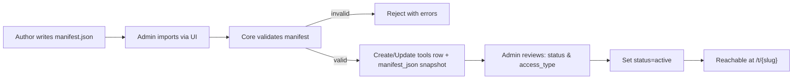
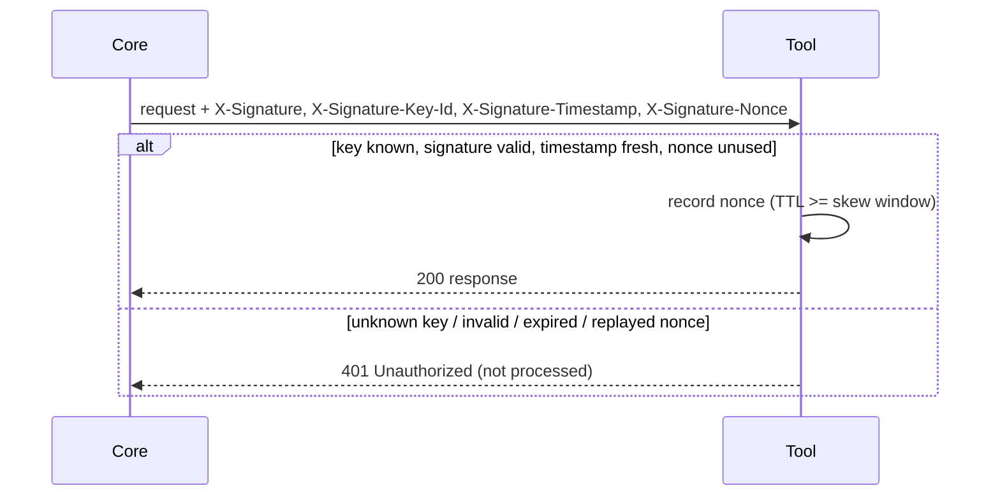
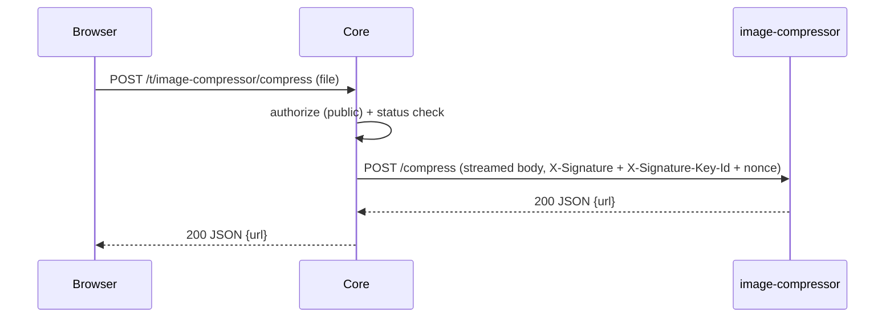

# Tools BPBJ — Tool Integration Contract

This document defines how an independent tool integrates with Core: its **manifest**, the **request/response contract**, the **health-check contract**, and a worked example. It is a specification — no tool is implemented in this phase.

## 1. Principles

- **DB is authoritative.** The manifest supplies seed/config values. Operational **status** and **security configuration** live in the database and override the manifest.
- **Core is the only authorization point.** Tools trust requests from Core **only after verifying Core's internal signature**; the private network alone is not treated as identity.
- **Language-agnostic.** Any tool that speaks HTTP can integrate (Python, PHP, Node.js, Go).
- **Zero Core code changes** are required to add a tool.

## 2. Tool Manifest

### 2.1 Canonical Example

```json
{
  "id": "image-compressor",
  "name": "Image Compressor",
  "version": "1.0.0",
  "description": "Compress JPG, PNG, and WebP images",
  "category": "Image",
  "access": "public",
  "runtime": "python",
  "upstream": "http://image-compressor:8000",
  "healthcheck": "/health"
}
```

### 2.2 Field Semantics

| Field | Type | Required | Meaning | Validation | Set by | DB overridable |
|-------|------|----------|---------|------------|--------|----------------|
| `id` | string | Yes | Stable unique identifier; becomes the seed for `tools.slug`. | `^[a-z0-9](?:[a-z0-9]|-(?=[a-z0-9])){0,62}$`, length 1–63, unique. No double/leading/trailing hyphens. | Author | slug editable, id retained |
| `name` | string | Yes | Display name. | 1–128 chars. | Author | Yes |
| `version` | string | Yes | Tool version (full semver, incl. pre-release/build). | SemVer 2.0.0: `^(0|[1-9]\d*)\.(0|[1-9]\d*)\.(0|[1-9]\d*)(?:-[0-9A-Za-z-.]+)?(?:\+[0-9A-Za-z-.]+)?$`. | Author | Yes |
| `description` | string | Yes | Short description. | ≤512 chars. | Author | Yes |
| `category` | string | No | Catalog grouping. | ≤64 chars. | Author | Yes |
| `access` | string | Yes | Default access model. | `public` \| `token`. | Author | **Yes — DB authoritative** |
| `runtime` | string | Yes | Implementation runtime. | `python`\|`php`\|`node`\|`go`. | Author | Yes |
| `upstream` | string (URL) | Yes | Internal upstream base URL. | must be an internal host; no public scheme/host. | Author | Yes (validated) |
| `healthcheck` | string (path) | Yes | Health endpoint path. | starts with `/`. | Author | Yes |
| `displayOrder` | integer | No | Catalog ordering hint. | ≥0. | Author | Yes |
| `icon` | string | No | Icon name/path hint. | ≤64 chars. | Author | Yes |
| `schemaVersion` | string | No | Manifest schema version. | e.g. `1`. | Author | No |

### 2.3 Optional Fields (Extended)

```json
{
  "displayOrder": 10,
  "icon": "image",
  "schemaVersion": "1",
  "contact": "bpbj@lampungprov.go.id",
  "docs": "https://internal/…"
}
```

> **Note:** the **per-tool** internal HMAC secret used for Core→tool signing (§4.5) is **never** placed in the manifest (manifests may be stored/inspected). It is provisioned separately via secret file/env for both Core and that specific tool.

### 2.4 Authoritative Runtime State (NOT in manifest)

The following are **never** dictated by the manifest and are stored only in the DB:

- **Status:** `draft` | `active` | `maintenance` | `disabled`.
- **Security configuration:** enforced access type, token requirements, rate limits, upload limits.
- **Maintenance message.**

> A manifest can *request* `access: "token"`, but only the DB decides the enforced value. The manifest cannot force a tool active or public.

### 2.5 JSON Schema

```json
{
  "$schema": "https://json-schema.org/draft/2020-12/schema",
  "$id": "https://bpbj.lampungprov.go.id/schemas/tool-manifest.schema.json",
  "title": "Tools BPBJ Tool Manifest",
  "type": "object",
  "additionalProperties": false,
  "required": ["id", "name", "version", "description", "access", "runtime", "upstream", "healthcheck"],
  "properties": {
    "id": { "type": "string", "pattern": "^[a-z0-9](?:[a-z0-9]|-(?=[a-z0-9])){0,62}$", "maxLength": 63 },
    "name": { "type": "string", "minLength": 1, "maxLength": 128 },
    "version": { "type": "string", "pattern": "^(0|[1-9]\\d*)\\.(0|[1-9]\\d*)\\.(0|[1-9]\\d*)(?:-[0-9A-Za-z-.]+)?(?:\\+[0-9A-Za-z-.]+)?$" },
    "description": { "type": "string", "minLength": 1, "maxLength": 512 },
    "category": { "type": "string", "maxLength": 64 },
    "access": { "type": "string", "enum": ["public", "token"] },
    "runtime": { "type": "string", "enum": ["python", "php", "node", "go"] },
    "upstream": { "type": "string", "format": "uri", "minLength": 1 },
    "healthcheck": { "type": "string", "pattern": "^/" },
    "displayOrder": { "type": "integer", "minimum": 0 },
    "icon": { "type": "string", "maxLength": 64 },
    "schemaVersion": { "type": "string", "maxLength": 16 }
  }
}
```

> **Validation notes:** `format: uri` is an **annotation only** in JSON Schema Draft 2020-12 — Core MUST still apply its own semantic URL/SSRF validation (§3) rather than relying on `format`. The `id` and `version` patterns are validated with the schema above and reject, e.g., `a--b`, `-a`, `a-`, `A`, `a_b` (id) and `1.0`, `v1.0.0`, `01.0.0` (version), while accepting full SemVer such as `1.0.0-rc1` and `1.0.0+build.5`.

## 3. Manifest Lifecycle



- **Import/validate:** schema + semantic checks; reject unknown fields or bad upstream.
- **Upstream SSRF validation:** the manifest's `upstream` is validated against the internal allowlist policy (scheme `http`/`https`, Docker service hostname or allowlisted internal IP range, allowed port, no userinfo/traversal). DNS-rebinding is prevented by **connecting to the exact validated IP** (pinned IP, no second unvalidated lookup between check and connect). Public hosts, `localhost`, link-local (e.g. `169.254.0.0/16`) and cloud-metadata addresses are **rejected** at import and re-checked before each connection. See `architecture.md` §4.5.
- **Diff/update semantics on re-import:** manifest fields update the **seed** columns (name, description, category, version, runtime, upstream, healthcheck) but **admin overrides** — `status`, enforced `access_type`, maintenance message, display order — are **preserved** unless the admin explicitly opts to apply manifest defaults.
- **Snapshot:** the raw manifest is stored in `tools.manifest_json` for reference/audit.

## 4. Request Contract (Core → Tool)

### 4.1 Routing

- Public route: `GET|POST|… /t/{slug}/{tool-path}`
- Core strips the `/t/{slug}` prefix and forwards `{tool-path}` (plus query string) to `{upstream}{tool-path}`.

### 4.2 Method & Body

- **Method preserved** (GET/POST/PUT/PATCH/DELETE/HEAD/OPTIONS).
- **Body streamed** both directions (no full buffering) to support large uploads/downloads, **while maintaining full-body integrity**: Core computes the body digest incrementally as it streams and covers it with the request signature (§4.5). An upload is never accepted without a verified body digest.
- **Gateway body limit:** configurable max request size (default e.g. 25 MB) enforced at Core; tools may enforce their own lower limits.

### 4.3 Headers

| Direction | Header | Handling |
|-----------|--------|----------|
| Client → Core | `Authorization`, cookies for *tool* auth | **Stripped** — Core performs its own auth; tool auth cookies are not forwarded. |
| Client → Core | `Cookie` (Core session) | Consumed by Core, not forwarded. |
| Core → Tool | `X-Signature`, `X-Signature-Key-Id`, `X-Signature-Timestamp`, `X-Signature-Nonce` | **Internal auth** — per-tool HMAC signature so the tool can prove the caller is Core (see §4.5). |
| Core → Tool | `X-Gateway: tools-bpbj-core` | Identifies the logical caller (informational). |
| Core → Tool | `X-Forwarded-For`, `X-Forwarded-Proto`, `X-Forwarded-Host` | Injected for tool awareness/logging. |
| Core → Tool | `X-Tool-Slug`, `X-Access-Type` | Convenience context (informational). |
| Tool → Core | Hop-by-hop headers (`Connection`, `Keep-Alive`, `Transfer-Encoding`, `Upgrade`, …) | Removed. |
| Core → Client | Response headers | Passed through except hop-by-hop / internal signature headers (never leaked to browser). |

### 4.4 Timeouts

- Configurable connect/read/write timeouts at the proxy (e.g. connect 5s, idle 60s; long-running ops configurable per tool if needed).
- On timeout, Core returns `504 Gateway Timeout`.

### 4.5 Internal Authentication & Trust Model

**Core authenticates to the tool with an HMAC signature using a secret unique to that tool; the tool verifies it. The private network is defense-in-depth, not identity.**

**Signature headers (sent by Core, verified by the tool):**

| Header | Meaning |
|--------|---------|
| `X-Signature` | `HMAC-SHA256(secret, canonicalString)` hex-encoded. |
| `X-Signature-Key-Id` | Identifier of the secret/key used (supports dual-key rotation). |
| `X-Signature-Timestamp` | Unix epoch seconds at signing; tools reject if outside a ±60s skew window. |
| `X-Signature-Nonce` | Random per-request value; the tool **must** cache it to reject replays. |
| `X-Gateway` | `tools-bpbj-core` (informational). |

**Canonical string:** `METHOD \n path \n query \n keyId \n timestamp \n nonce \n bodyHash`.

**Body integrity rule (applies to ALL requests with a body, including streamed uploads):**

- `bodyHash` is **never** a placeholder for a real body. For every request that carries a body, `bodyHash` MUST be the hash of that body's actual bytes. There is **no bodyless marker** for uploads.
- **Integrity is always covered by the signature.** The tool must be able to (a) confirm the body bytes it received match `bodyHash`, and (b) confirm `bodyHash` was covered by the HMAC. Both must hold, or the request is rejected.
- For **buffered/small bodies**, Core computes `bodyHash = sha256(body)` before signing and the tool recomputes it over the received body.
- For **streamed uploads** (where buffering the whole body is undesirable), Core computes the digest **incrementally while streaming** — hashing the exact bytes it forwards. Because the HMAC must be sent in the headers (before the body completes), Core uses a **per-request signed body digest** delivered in a header/trailer the tool can verify:
  - Core streams the body while computing `sha256` incrementally.
  - Core sends `Content-Digest` (RFC 9530, e.g. `sha-256=:base64:`) reflecting that digest, plus two trailers covered by the HMAC: `X-Signature-Body-Digest` (the digest, formatted `sha-256=<hex>`) and `X-Signature-Body-Sig` (the HMAC over the canonical string + the digest value).
  - The tool recomputes the hash of the received body and compares it to the signed digest; a mismatch (importantly: an **empty/garbled/truncated body**) is rejected with `400`/`401`.
- **If a tool (or Core) cannot guarantee full-body integrity for a given request, the request MUST be rejected** — never accepted on timestamp+nonce alone. Processing un-integrity-checked uploads is non-compliant.

This closes the gap where a "bodyless marker" would let an attacker tamper with or replace the uploaded content while the signature still validated.

**Per-tool secret:** each tool has its **own** secret (no global shared secret); the matching secret is delivered to that tool via secret file/env and is never in the manifest.

**Rotation (zero downtime):** the tool may hold **two** secrets (current + next). Deliver the new key so the tool accepts both, switch Core to sign with the new key, then revoke the old key after the transition window drains. Either key verifies during the window.

**Tool verification obligation (REQUIRED for compliance):**

1. Reject with `401` if any signature header is missing.
2. Look up the secret by `X-Signature-Key-Id`; reject unknown/revoked keys.
3. Recompute the HMAC with that secret and compare in constant time.
4. Reject if the timestamp is outside the skew window.
5. **Verify body integrity:** recompute the body hash and confirm it matches the `bodyHash` covered by the signature (directly, or via the signed `Content-Digest`/`X-Signature-Body-Digest` trailer for streamed uploads). A mismatch, truncation, or empty body → reject (`400`/`401`). There is no accepting a body without integrity verification.
6. **Reject a replayed `keyId`+nonce** using a nonce cache with a TTL at least the skew window (default 2 minutes); the cache must be bounded in size and the check-and-store **atomic**.
7. Only then process the request.

**Rules:**

- Per-tool secrets are provisioned via **secret file/env**, never hardcoded; they are rotatable and distinct from user tokens/admin session secrets.
- A tool that does not verify the signature **and** the nonce is **non-compliant**.
- Tools must be reachable **only from Core** on the internal network; Core restricts outbound connections to the internal allowlist.
- Tools MUST NOT be published to the host or the `proxy` network.
- Internal signature headers are stripped from responses so they never reach the browser.
- **Future option:** mTLS can replace/augment HMAC in a later phase; not required now.



## 5. Response Contract (Tool → Core)

- **Status codes** pass through (2xx/3xx/4xx/5xx) with their semantics.
- **Bodies** streamed back unchanged.
- **Error surface:** Core may replace upstream failure with a branded error page for HTML clients, or pass JSON through for API clients.
- **Hop-by-hop headers** stripped; `Content-Length`/`Content-Type` preserved when present.

### 5.1 Standard Error Shape (tool JSON APIs)

Consistent with the project API convention:

```json
{
  "success": false,
  "error": "invalid_input",
  "message": "Unsupported image format"
}
```

Success:

```json
{
  "success": true,
  "data": { "url": "/t/image-compressor/files/abc123.webp" }
}
```

## 6. Required Endpoints

| Endpoint | Required | Contract |
|----------|----------|----------|
| `GET {healthcheck}` (default `/health`) | **Yes** | HTTP 200 + JSON status. |
| `GET /manifest` | Optional | Serves the tool's `manifest.json` for import. |
| Tool functionality routes | Yes | Any paths the tool serves; proxied under `/t/{slug}/`. |

### Health Response

```json
{
  "status": "ok",
  "version": "1.0.0",
  "uptimeSeconds": 3600
}
```

- `status`: `ok` means healthy. `degraded`/`unhealthy`/HTTP ≥500 means unhealthy.
- Contract: HTTP 200 **and** `status == "ok"` → `healthy`; otherwise `unhealthy`.

## 7. Health-Check Contract (Core side)

Bounded so polling never overloads Core or the tools. These are the values the
implementation uses (env keys are set in `core.env`):

| Parameter | Default | Env key | Notes |
|-----------|---------|---------|-------|
| Interval | **30s** per tool | `HEALTHCHECK_INTERVAL` | `0` disables the poller entirely. |
| Per-check timeout | **5s** | `HEALTHCHECK_TIMEOUT` | Hard timeout; a slow tool becomes `unhealthy`, the poller never hangs. |
| Max concurrency | **5** simultaneous checks | `HEALTHCHECK_MAX_CONCURRENT` | Prevents a burst across many tools from spiking Core. |
| Retries | **none** within a sweep | - | The poller does not retry; the next interval is the retry. There is no `HEALTHCHECK_RETRIES`. |
| Overlapping sweeps | **disabled** | - | If a sweep is still running, the next one is skipped. |
| Per-tool overlap | **disabled** | - | A second concurrent probe of the same tool is refused. |
| DB write | one row per tool per sweep | - | Bounds `tool_health_checks` write load. |

- Core polls **only active** tools (status `active` and not soft-deleted). Each tool's `healthcheck` path is used; the path must start with `/` and a `..` sequence is rejected.
- A slow tool never blocks checks of other tools (isolated per check). The check response body is drained up to 4 KiB.
- Result recorded in `tool_health_checks` (`status`, `http_status_code`, `latency_ms`, `checked_at`, `error_message`) - **no request/response bodies or secrets** stored.
- `error_message` holds only a **fixed reason code**, never raw transport text: `timeout`, `connection failed`, `tls handshake failed`, `upstream address not allowed`, `unexpected status code`, `response body too large`, `request failed`. This prevents leaking internal hostnames, IPs, or ports.
- Health checks reuse the **same SSRF allowlist and pinned-IP policy** as the gateway - they do not bypass it.
- A transition to `unhealthy` records the activity `health.check_failed`; a transition back records `health.check_recovered`. Steady state records nothing.
- The latest result drives the admin dashboard badge and `GET /admin/health`; history supports diagnostics.
- Health polling does **not** change tool status automatically - status is an admin decision.

## 8. Example Integration (Python / FastAPI)

> Illustrative only — not an implementation deliverable of Phase 0.

**`manifest.json`**

```json
{
  "id": "image-compressor",
  "name": "Image Compressor",
  "version": "1.0.0",
  "description": "Compress JPG, PNG, and WebP images",
  "category": "Image",
  "access": "public",
  "runtime": "python",
  "upstream": "http://image-compressor:8000",
  "healthcheck": "/health"
}
```

**`Dockerfile` (sketch)**

```dockerfile
FROM python:3.12-slim
WORKDIR /app
COPY requirements.txt .
RUN pip install --no-cache-dir -r requirements.txt
COPY . .
EXPOSE 8000
HEALTHCHECK --interval=30s --timeout=5s \
  CMD python -c "import urllib.request;urllib.request.urlopen('http://localhost:8000/health')"
USER 10001
CMD ["uvicorn", "app:app", "--host", "0.0.0.0", "--port", "8000"]
```

**Health endpoint (sketch)**

```python
@app.get("/health")
def health():
    return {"status": "ok", "version": "1.0.0"}
```

**Internal signature verification (sketch — REQUIRED for compliance)**

```python
import hmac, hashlib, time

# Per-tool secrets keyed by keyId. During rotation, both current and next keys are
# present so either verifies (zero downtime). Loaded from secret file/env, never hardcoded.
SECRETS = {
    "k2": load_secret("INTERNAL_SECRET_NEXT"),   # incoming key (rotation)
    "k1": load_secret("INTERNAL_SECRET_CURRENT"), # current key
}

SKEW = 60  # seconds; nonce cache TTL must be >= this (we use >= 2x below)

def verify_core(request, received_body: bytes, nonce_cache) -> bool:
    sig   = request.headers.get("X-Signature")
    keyid = request.headers.get("X-Signature-Key-Id")
    ts    = request.headers.get("X-Signature-Timestamp")
    nonce = request.headers.get("X-Signature-Nonce")
    if not (sig and keyid and ts and nonce):
        return False
    secret = SECRETS.get(keyid)          # reject unknown / revoked keyId
    if secret is None:
        return False
    if abs(time.time() - int(ts)) > SKEW:  # clock-skew window
        return False

    # Body integrity is ALWAYS covered by the signature (no bodyless marker).
    # Recompute over the exact received bytes (for streamed uploads the tool hashes
    # the stream and compares to the signed Content-Digest / X-Signature-Body-Digest).
    body_sha256 = hashlib.sha256(received_body).hexdigest()
    signed_digest = request.headers.get("X-Signature-Body-Digest")
    if signed_digest is not None and signed_digest != body_sha256:
        return False                      # truncated / tampered / empty body

    canonical = "\n".join(
        [request.method, request.url.path, request.url.query, keyid, ts, nonce, body_sha256]
    )
    expected = hmac.new(secret, canonical.encode(), hashlib.sha256).hexdigest()
    if not hmac.compare_digest(expected, sig):   # constant-time compare
        return False
    # MANDATORY atomic replay protection: reject a reused (keyId, nonce).
    # nonce_cache.remember must be an atomic check-and-store (insert-if-absent/CAS),
    # TTL >= 2*SKEW, bounded in size, so concurrent duplicates admit exactly one.
    return nonce_cache.remember(f"{keyid}:{nonce}", ttl_seconds=2 * SKEW)
```

**Logging note:** tools must not log the internal secret, the signature, user tokens/cookies, or request/response bodies.

**Integration steps**

1. Build & deploy the tool container on the internal tool network with hostname `image-compressor`.
2. Do **not** publish its ports; it must be reachable only from Core.
3. Import `manifest.json` in Admin → Tools.
4. Review `access_type` (public) and set `status=active`.
5. The tool is now available at `/t/image-compressor/`.



## 9. Compatibility & Versioning

- **Manifest schema versioning** via optional `schemaVersion`; Core validates against the declared/known schema.
- **Tool versions** follow semantic versioning; version is informational in the catalog.
- **Backward compatibility:** Core must tolerate manifests missing optional fields; unknown fields are rejected (fail-fast) or warned per validation policy.
- **Contract stability:** the request/response and health contracts are versioned; breaking changes require coordinated Core + tool updates.
